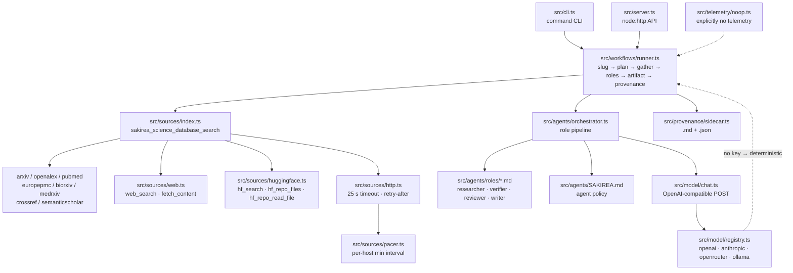

# Sakirea

Research workflows over key-free science databases — a from-scratch TypeScript reimplementation of the engines of the open-source AI research agent **Feynman** ([github.com/Companion-Inc/feynman](https://github.com/Companion-Inc/feynman), MIT).

- **Zero runtime dependencies.** Node's standard library and global `fetch` only. (`typescript` is the single devDependency.)
- **Key-free sources.** arXiv, OpenAlex, PubMed, Europe PMC, bioRxiv, medRxiv, Crossref, Semantic Scholar — no API keys, no accounts.
- **No telemetry.** Nothing is collected, stored, or sent. See [ENGINE-DOSSIER.md](ENGINE-DOSSIER.md) for the contrast with upstream's PostHog client.
- **Provenance by default.** Every artifact ships with a Markdown + JSON sidecar recording sources, statuses, endpoints, tool, model, and mode.

Built as an open reimplementation of the engines of Feynman (github.com/Companion-Inc/feynman, MIT) — see [ENGINE-DOSSIER.md](ENGINE-DOSSIER.md).

## Install

```powershell
git clone <this-repo> sakirea   # or copy the directory
cd sakirea
npm install                     # installs typescript (dev only)
```

Requires Node ≥ 22.18 (tested on 24.21). TypeScript runs directly through Node's type stripping — there is no build step.

## Quickstart

```powershell
# one-shot deep research on a topic (deterministic mode, no key needed)
node bin/sakirea.mjs "CRISPR base editing therapies"

# with an LLM key present, the same command runs the role pipeline in llm mode
$env:OPENAI_API_KEY = "sk-..."
node bin/sakirea.mjs deepresearch "CRISPR base editing therapies" --mode llm
```

Each run leaves staged artifacts on disk:

```
outputs/.plans/<slug>.md                 plan, task ledger, verification log
outputs/.drafts/<slug>-draft.md          evidence notes
outputs/<slug>.md                        the final artifact
outputs/<slug>.provenance.md             human-readable provenance
outputs/<slug>.provenance.json           machine-readable provenance
```

## CLI

```
sakirea "<topic>"                          run deep research (default workflow)
sakirea <workflow> "<topic>"               run a named workflow
sakirea sources                            list science-database connectors
sakirea workflows                          list workflows
sakirea search <source> "<query>"          one-shot source search
sakirea serve [--port 4599] [--host H]     start the HTTP API

flags: --mode deterministic|llm   --out <dir>   --model <id>
       --limit 1..20             --sort relevance|pub_date
       --host <host> --port <n>  -h | --help   -V | --version
```

Examples:

```powershell
node bin/sakirea.mjs sources
node bin/sakirea.mjs search openalex "CRISPR gene editing" --limit 3
node bin/sakirea.mjs search arxiv "2401.12345"            # arXiv IDs resolve exactly
node bin/sakirea.mjs lit "long COVID exercise intolerance" --out .\reviews
node bin/sakirea.mjs --version
```

Workflows: `deepresearch`, `lit`, `review`, `audit`, `replicate`, `recipe`, `compare`, `draft` (writes `papers/`), `autoresearch`, `summarize`.

### Modes

| Mode | When | What happens |
|------|------|--------------|
| `deterministic (no LLM key)` | no API key configured | evidence is gathered, then the artifact is synthesized from the source records with template sections and clearly labeled |
| `llm` | `OPENAI_API_KEY` / `ANTHROPIC_API_KEY` / `OPENROUTER_API_KEY` set | one OpenAI-compatible chat-completions call per role (`researcher → verifier → reviewer → writer`, per workflow), falling back to deterministic synthesis if a call fails |

Model selection lives in `src/model/registry.ts` (defaults: `gpt-4o-mini`, `claude-sonnet`; local Ollama at `http://localhost:11434/v1`; `SAKIREA_MODEL` overrides). Listing models needs no key.

Configuration lives in `~/.sakirea/settings.json`; `SAKIREA_HOME` redirects that directory (tests point it at a temp dir).

## HTTP API

`sakirea serve` starts a `node:http` server bound to `127.0.0.1:4599` (`--host` / `--port` to change). CORS is enabled (`Access-Control-Allow-Origin: *`) so browser apps can call it; JSON bodies are limited to 1 MiB; errors are always `{ "error": { "code", "message" } }`.

| Route | Method | Body | Returns |
|-------|--------|------|---------|
| `/api/health` | GET | — | `{ok, name, version}` |
| `/api/sources` | GET | — | connector list with `docs` + `endpoints` |
| `/api/workflows` | GET | — | workflow list with `agents`, `outputDir`, `args` |
| `/api/search` | POST | `{source, query, limit?, sort?}` | search envelope + provenance |
| `/api/workflows/:id/run` | POST | `{topic, outputDir?, mode?, model?}` | `{slug, artifactPath, provenancePath, status, ...}` |

```powershell
curl http://127.0.0.1:4599/api/health
curl http://127.0.0.1:4599/api/sources
curl http://127.0.0.1:4599/api/workflows

curl -X POST http://127.0.0.1:4599/api/search `
     -H "content-type: application/json" `
     -d '{"source":"openalex","query":"CRISPR gene editing","limit":3}'

curl -X POST http://127.0.0.1:4599/api/workflows/deepresearch/run `
     -H "content-type: application/json" `
     -d '{"topic":"CRISPR base editing therapies","mode":"deterministic","outputDir":"./outputs"}'
```

`POST /api/workflows/:id/run` runs synchronously and writes the plan, draft, artifact, and provenance sidecars under `outputDir` (default `./outputs`), returning their paths.

## Architecture



Module map:

- `src/sources/` — connectors (`types.ts` = `SourceConnector {id, docs, endpoints, search()}`), shared HTTP with injectable `fetch`, the request pacer, a hand-rolled arXiv Atom reader (`xml.ts`), plus web and Hugging Face engines.
- `src/agents/` — `SAKIREA.md` policy, markdown role personas, loader, orchestrator (LLM vs deterministic).
- `src/model/` — provider registry and one chat-completions helper.
- `src/workflows/` — registry of ten workflows, prompt templates (`prompts/<id>.md`), and the runner that stages artifacts.
- `src/provenance/` — sidecar writer (status vocabulary: `verified` = returned by two independent databases, `unverified` = one database, `blocked` = source failed).
- `src/server.ts`, `src/cli.ts`, `src/telemetry/noop.ts`.

## Privacy

- No telemetry, no analytics, no crash reporting, no phone-home (see `src/telemetry/noop.ts`).
- Network calls go only to the endpoints a run explicitly queries: the eight science databases, DuckDuckGo's HTML endpoint when you call `web_search`, the Hugging Face Hub when you call the HF tools, and your configured LLM provider in llm mode.
- API keys are read from environment variables only and are never written to artifacts or provenance files (OpenAlex `api_key` query values are redacted in recorded endpoints).

## Development

```powershell
$env:npm_config_cache = "$PWD\.npm-cache"   # required in this sandbox
npm test          # node --test --test-isolation=none (in-process, zero network)
npm run typecheck # tsc --noEmit
```

Tests inject a fake `fetch`, so the suite never touches the network. Note: Node ambient types (`@types/node`) must be resolvable for `npm run typecheck`; this repo intentionally lists `typescript` as its only devDependency.

## Roadmap

- Optional arXiv topic search improvements (upstream restricts arXiv to ID lookup; Sakirea also allows lexical `search_query`).
- Europe PMC full-text section retrieval (upstream `science-database-europepmc-fulltext.ts`).
- OpenAlex semantic/exact filter syntax (upstream `science-database-openalex-exact.ts`).
- Skill packs (upstream `skills/*/SKILL.md`) and the session-log workflow (`prompts/log.md`).

## License

MIT — see [LICENSE](LICENSE). Copyright (c) 2026 Consult Sciences / consultsciences.
